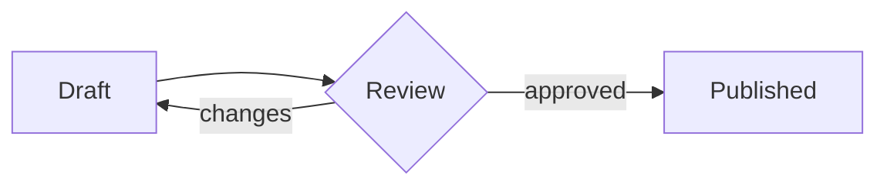

# vitepress-mermaid

[Mermaid](https://mermaid.js.org/) diagrams and charts in [VitePress](https://vitepress.dev/) markdown.

- A markdown-it plugin turns ` ```mermaid ` fences into a `<Mermaid>` component; other fences keep VitePress highlighting.
- The component renders in the browser only, loads mermaid lazily (pages without diagrams don't download it) and redraws when the dark theme is toggled.
- It does not import `vitepress`, so no `ssr.noExternal` setup is needed. Works with VitePress 1 and 2.
- Labels are measured with the page font and the `.vp-doc` paragraph style is neutralised inside diagrams, so node text is not clipped.
- A syntax error shows the diagram source in red with a `data-mermaid-error` attribute and a console error instead of an empty block.

## Install

Not on npm yet; install from GitHub with a tag:

```sh
npm i -D mermaid github:mokevnin/vitepress-mermaid#v0.1.0
```

`mermaid` (11 or 12) and `vue` 3 are peer dependencies. VitePress already brings `vue`.

## Setup

`docs/.vitepress/config.mts`:

```ts
import { defineConfig } from 'vitepress'
import { mermaidMarkdown } from '@mokevnin/vitepress-mermaid/markdown'

export default defineConfig({
  markdown: {
    config(md) {
      md.use(mermaidMarkdown)
    },
  },
})
```

`docs/.vitepress/theme/index.ts`:

```ts
import DefaultTheme from 'vitepress/theme'
import type { Theme } from 'vitepress'
import { enhanceAppWithMermaid } from '@mokevnin/vitepress-mermaid/client'
import '@mokevnin/vitepress-mermaid/style.css'

export default {
  extends: DefaultTheme,
  enhanceApp({ app }) {
    enhanceAppWithMermaid(app)
  },
} satisfies Theme
```

## Usage

````md

````

Charts work the same way (`xychart`, `pie`, `sankey`, ...). Wrap non-ASCII labels in quotes and use ASCII node ids.

## Options

`mermaidMarkdown` accepts `{ lang, component }` to change the fence language (default `mermaid`) or the component name (default `Mermaid`).

`enhanceAppWithMermaid(app, config)` merges a [mermaid config](https://mermaid.js.org/config/schema-docs/config.html) over the defaults: `securityLevel: 'strict'`, the page font, `default`/`dark` theme from VitePress, and a chart palette that stays readable in both themes. `themeVariables` are merged key by key:

```ts
enhanceAppWithMermaid(app, {
  flowchart: { curve: 'basis' },
  themeVariables: { pie1: '#e8590c' },
})
```

## Checking diagrams

Rendering happens in the browser, so `vitepress build` does not catch mermaid syntax errors. Open the pages (or run a browser test) and look for `[data-mermaid-error]`.

## Development

```sh
npm ci
mise run check   # node --test and tsc
```

## License

MIT
